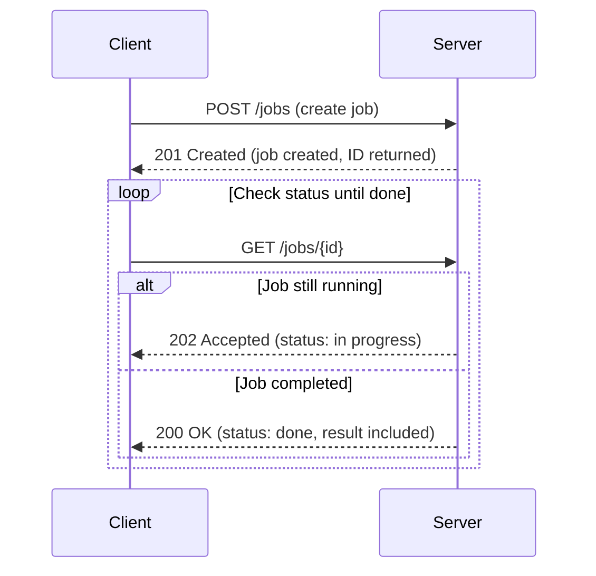
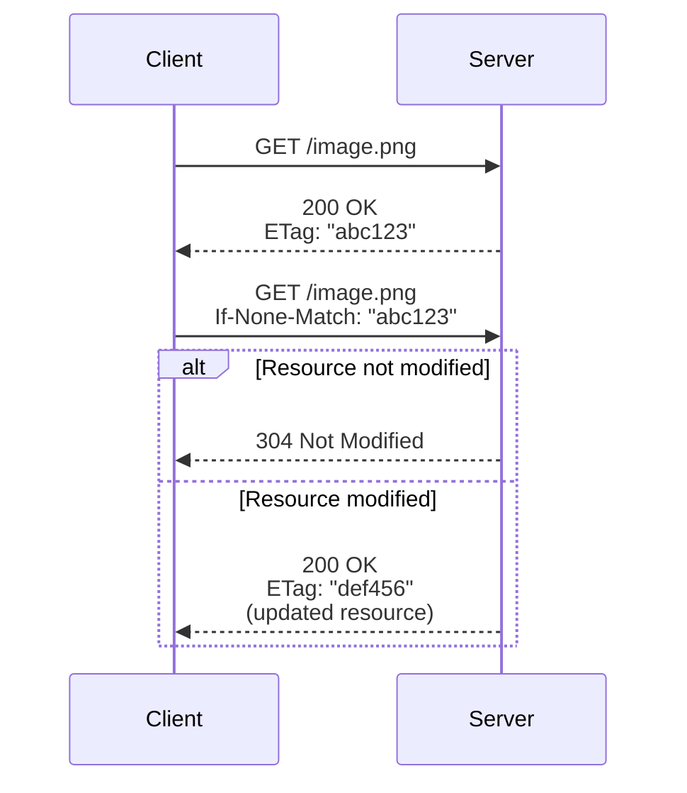

# HTTP API Design Standard

## Introduction

This document defines a consistent style for designing HTTP APIs.

Different consumers have different requirements, [non-functional requirements (NFRs)](https://en.wikipedia.org/wiki/Non-functional_requirement) and users. For every API, evaluate whether this style fits the intended consumers or whether another design serves them better.

The driving quality attributes of this standard are **simplicity**, **consistency**, **learnability** and **compliance with established standards**.

### Conformance Language

The key words **MUST**, **MUST NOT**, **SHOULD**, **SHOULD NOT** and **MAY** are to be interpreted as described in [RFC 2119](https://www.rfc-editor.org/rfc/rfc2119) and [RFC 8174](https://www.rfc-editor.org/rfc/rfc8174).

### REST and RESTful APIs

According to [Roy Fielding](https://en.wikipedia.org/wiki/Roy_Fielding), whose dissertation "[Architectural Styles and the Design of Network-based Software Architectures](https://ics.uci.edu/~fielding/pubs/dissertation/top.htm)" introduced REST, an API is RESTful if it satisfies six constraints:

1.  Uniform interface
2.  Client–server
3.  Stateless
4.  Cacheable
5.  Layered system
6.  Code on demand (optional)

The constraints are explained in the appendix "Roy Fielding's REST Constraints".

A common misconception is that REST forbids verbs in URIs. Fielding's dissertation does not mention verbs at all, and its definition of a resource is very broad: it neither requires mapping database entities to endpoints nor rules out verbs.

This standard does not strictly follow REST, but APIs **SHOULD** conform to the six constraints. Some aspects, such as [HATEOAS](https://en.wikipedia.org/wiki/HATEOAS), are optional (see "HATEOAS").

## General Conventions

### Naming

-   Field names **MUST** use [camelCase](https://en.wikipedia.org/wiki/Camel_case):
    -   The first character is lowercase.
    -   Each following word starts with an uppercase letter, e.g. `firstSecondThird`.
    -   Abbreviations stay uppercase, e.g. `ITUser`.
-   Fields holding a collection **MUST** use the plural form (`users`).
-   Fields holding a single entity **MUST** use the singular form (`user`).
-   Resource paths **SHOULD** use verbs for operations that go beyond basic CRUD, e.g. `POST /orders/{id}/cancel`.

### Response Structure

-   Response data **MUST** be returned below the top-level `data` field.
-   Below `data`, the entity name **MUST** be used as a container for the entity or entities, even if only a single entity is returned.
-   Control information such as pagination **MUST** be placed in separate top-level fields, not inside `data`.

### Payload Design

-   Payloads and response bodies **MUST** be modelled for the needs of the consumers. Exposing the database schema 1:1 is not desired unless the endpoint is pure CRUD or there is a good reason for it.
-   Payloads and response bodies **MUST NOT** contain more data than consumers need (no over-fetching).
-   Responses **MUST NOT** contain information that reveals business secrets, poses a security risk or violates data-protection regulations such as the [GDPR](https://gdpr-info.eu/) – neither in regular nor in error responses.

### HTTP Methods

-   `POST` **MUST** be used to create resources (when the server generates the identifier) and for non-idempotent operations.
-   `PUT` **MUST** be used to replace a whole resource, e.g. updating 10 of 10 fields.
-   `PATCH` **MUST** be used to partially modify a resource, e.g. updating 3 of 10 fields.

### Other Conventions

-   HTTP status codes **MUST** be chosen according to [RFC 9110](https://www.rfc-editor.org/rfc/rfc9110#name-status-codes); see the appendix "HTTP Status Codes".
-   Error and failure responses **MUST** follow [RFC 9457: Problem Details for HTTP APIs](https://www.rfc-editor.org/rfc/rfc9457.html).
-   Localized content **MUST** be requested via the `Accept-Language` header (see "Localization").
-   [ETags](https://en.wikipedia.org/wiki/HTTP_ETag) **MUST** be used wherever applicable (see "Caching via ETags").

### Examples

Single entity:

```
GET /users/123

{
  "data": {
    "user": {
      "username": "Foo"
    }
  }
}
```

Collection of entities:

```
GET /users

{
  "data": {
    "users": [
      { ... },
      { ... }
    ]
  }
}
```

## Response Categories

This standard distinguishes three outcomes of an API call.

| Category | Meaning | Status code range | Body |
|---|---|---|---|
| Success | The operation completed as expected. | 200–299 | `data` envelope |
| Failure | The request could not be processed because of a client-side problem, e.g. invalid input. | 400–499 | RFC 9457 Problem Details |
| Error | The request could not be processed because of a server-side problem. | 500–599 | RFC 9457 Problem Details |

-   Success responses **MUST** use a status code from the 200–299 range.
-   Failure responses **MUST** use a status code from the 400–499 range and **MUST** use RFC 9457.
-   Error responses **MUST** use a status code from the 500–599 range and **MUST** use RFC 9457.

## Error and Failure Messages

A good error message states the cause and, where possible, tells the reader – explicitly or implicitly – how to resolve the problem. Violations of business rules, invariants and validation rules should almost always be understandable and usually solvable by the user.

Syntax errors and infrastructure problems must be handled gracefully and tell the user that they cannot do anything about it. Monitoring should already have alerted the operators, e.g. about an unavailable database.

If the user should contact support, say so explicitly and provide a way to do it.

A useless error message:

```
An error occurred.
```

A useful error message:

```
An error occurred in the ProcessActivation component; the process can't be
activated without granting the `modify` permission to the logged-in user.
```

The message names the actor ("logged-in user"). In other contexts the actor could be an "approver" or a "supervisor" – use the ubiquitous language of the domain and name the actual actor.

If naming details could leak knowledge that can be abused (attacks, data-protection violations, data mining), word the message more generally, e.g. "without the necessary permission" instead of naming the `modify` permission.

### Conventions

-   Each error **MUST** have a code that is unique within the service (see "Error Codes").
-   Error messages **MUST** contain all information required to understand the cause and to identify the components and actors involved, including relevant context such as IDs and entity types.
-   Error messages **MUST** consider the context of the consumer and **MUST NOT** reveal information the consumer is not allowed to see, including personal data protected by data-protection law.
-   Error messages **MUST NOT** reveal system internals in production:
    -   frameworks, libraries and languages used
    -   version numbers
    -   file and folder paths
    -   class paths and stack traces
    -   passwords or password hashes
-   Debug information **MUST** only be placed in the `debug` field, and this field **MUST NOT** be returned in production.
-   Whether error messages are translated is decided by the service.

### Example

[Problem Details](https://www.rfc-editor.org/rfc/rfc9457.html) response with extension members:

```
HTTP/1.1 403 Forbidden
Content-Type: application/problem+json

{
  "type": "https://api.example.com/errors/activation-process/AP-E0012",
  "status": 403,
  "title": "Activation process failed.",
  "detail": "An error occurred in the ProcessActivation component; the process
             can't be activated without granting the `activate` permission to
             the logged-in user.",
  "instance": "/processes/5190fca3-9975-4f74-9285-96bec302728c",
  "code": "AP-E0012",
  "permission": "activate",
  "user": "0b6c1c1e-4a7e-4d8a-9a43-1d1f0a6f3b21",
  "process": "5190fca3-9975-4f74-9285-96bec302728c",
  "affectedComponent": "ProcessActivation",
  "correlationId": "2173be5a-e421-4e3d-86ba-325c8007e22a",  // if used
  "occurredAt": "2009-11-04T19:55:41Z",                       // helps to search logs
  "debug": {                                                  // development and test only!
    "trace": [
      { "class": "App\\Module\\Processing\\Domain\\ProcessActivation", "line": 41 }
    ]
  }
}
```

The response identifies all involved components, entities and actors. The `debug` trace must not be present outside of development and test environments. (Comments are for illustration only; JSON does not allow comments.)

### Error Codes

An error code is a short, human-readable identifier of an error. For example, `AP-E1` identifies error `E1` in the **A**ctivation **P**rocess (`AP`) component. It is short enough to remember and write down, yet carries information.

Format: `<component>-<error>`, e.g. `0001-0001`, `TaxCalculator-021`, `AP-E1`.

#### Choosing the Component

The component names the sub-system or process in which the error happened. `CheckoutProcess` is coarse, `CartCalculator` is still a good component, while a value object such as `Money` is too fine-grained. For invariant violations, an exception at domain or aggregate level is usually appropriate, but rarely anything finer.

A possible exception hierarchy is `DomainException → AggregateException → InvariantViolationException`. Invariant violations should never happen; if they do, the domain model is in an invalid state, which is exceptional and not recoverable.

As a rule of thumb, use process names rather than names of internals. The goal is to narrow down the source of the error, to reference the component in tickets and to help developers find the right place even without a stack trace.

#### Conventions

-   Error codes **MUST** be human-readable; opaque values such as UUIDs **MUST NOT** be used.
-   Error codes **MUST** consist of the affected component, a dash `-` and an identifier of the error within that component.
-   The notation **MUST** be consistent throughout a service.
-   Error codes **MUST** be unique and **MUST NOT** be reused, so that the location of the error can be determined.
    -   Class names **MUST NOT** be used as error codes.
    -   Use stable, higher-level names of well-defined boundaries.
    -   When code moves to another component, its error codes must be updated.
-   Error responses **MUST** be documented in the service's OpenAPI description.
-   Error codes **SHOULD** be defined by the team that owns the service.

### The `type` Field

The `type` field is a [URI reference](https://www.rfc-editor.org/rfc/rfc3986). RFC 9457, section 3.1.1:

> The "type" member is a JSON string containing a URI reference that identifies the problem type. Consumers MUST use the "type" URI (after resolution, if necessary) as the problem type's primary identifier.

URNs such as `urn:uuid:123e4567-e89b-12d3-a456-426614174000` are valid as well. Depending on the consumer, it can be useful to use a resolvable URL that links to documentation about the problem.

### Example: Multiple Validation Errors

```
HTTP/1.1 422 Unprocessable Content
Content-Type: application/problem+json
Content-Language: en

{
  "type": "https://api.example.com/errors/validation-error",
  "title": "Your request is not valid.",
  "status": 422,
  "errors": [
    { "detail": "must be a positive integer", "pointer": "#/age" },
    { "detail": "must be 'green', 'red' or 'blue'", "pointer": "#/profile/color" }
  ]
}
```

## Pagination

This standard supports two ways to iterate through collections: **offset-based** and **page-based** pagination.

### Conventions

-   A paginated resource **MUST** paginate only one entity type.
-   A paginated resource **MUST** use either offset-based pagination (without totals) or page-based pagination.
    -   Offset-based pagination **SHOULD** only be chosen if calculating totals has a justifiable performance impact or no totals are needed.
-   The `limit` **MUST** be at least 1 and **MUST NOT** exceed a maximum defined by the service based on performance and payload size.
-   If the requested range is out of bounds, an empty array **MUST** be returned.

### Offset-based Pagination

Only a `limit` and an `offset` are given; no pages or totals are calculated.

-   `limit`: number of items to return.
-   `offset`: number of items to skip.

`?offset=100&limit=25` returns items 101 to 125, if they exist. The response does not contain a `pagination` field, because totals are not calculated.

### Page-based Pagination

The total number of items is calculated, and a specific page can be requested, e.g. `?page=12`.

The response contains a top-level `pagination` field, so consumers know the pagination context without calculating it. It is a top-level field so that the control structure is not mixed with the data structure in `data`.

Required properties:

-   `currentPage`: the requested page number.
-   `totalPages`: total number of pages.
-   `perPage`: number of items per page.
-   `totalItems`: total number of items.

Optional properties:

-   `nextPage`: number of the next page, or `null`.
-   `previousPage`: number of the previous page, or `null`.

### Example

```
{
  "data": {
    "posts": [
      { "id": 1, "title": "First Post" },
      { "id": 2, "title": "Second Post" }
    ]
  },
  "pagination": {
    "currentPage": 1,
    "totalPages": 10,
    "perPage": 10,
    "totalItems": 100,
    "previousPage": null,
    "nextPage": 2
  }
}
```

## Versioning

-   The major version **MUST** be the first segment of the URI path, prefixed with a lowercase `v`, e.g. `/v1/some/resource`.
-   A new major version **MUST** use a new URI and **MUST NOT** affect older versions.
-   Minor and patch changes **MUST NOT** change the version in the URI.
-   The `Deprecation` header ([RFC 9745](https://www.rfc-editor.org/rfc/rfc9745)) **MUST** be used to announce deprecation.
-   The `Sunset` header ([RFC 8594](https://www.rfc-editor.org/rfc/rfc8594)) **MUST** be used to announce the removal date.
-   Monitoring **SHOULD** detect calls to deprecated endpoints and notify the affected consumers.

### Deprecation and Sunset Headers

The `Deprecation` header states since when a resource is deprecated. Its value is a Unix timestamp prefixed with `@`:

```
Deprecation: @1767225600
```

The `Sunset` header states after which date the resource will no longer be available:

```
Sunset: Thu, 31 Dec 2026 23:59:59 GMT
```

Combined, with a link to the deprecation notice:

```
Deprecation: @1767225600
Sunset: Thu, 31 Dec 2026 23:59:59 GMT
Link: <https://api.example.com/deprecations/v1>; rel="deprecation"; type="text/html"
```

Here the API is deprecated as of 1 January 2026 and removed after 31 December 2026, giving consumers twelve months to migrate.

## Localization

If content is translatable and can be requested in a given language:

-   The `Accept-Language` header **MUST** be used to request localized content.
-   The locale **MUST NOT** be part of the path, e.g. `/en/posts`.
-   The locale **MUST NOT** be a query parameter, e.g. `/posts?lang=en`.
-   The response **SHOULD** state the language actually used in the `Content-Language` header.

```
Accept-Language: <language>[;q=<quality>], <language>[;q=<quality>] ...
Accept-Language: en-US, en;q=0.8, fr;q=0.6
```

The `q` value is the relative preference. The example prefers American English, falls back to generic English and uses French as a last resort.

Use specific locales such as `de-CH` instead of `de` where wording differs between regions.

## Delete Operations

The response to a successful `DELETE` request **MAY** be empty or contain a representation of the status of the action. Suitable status codes ([RFC 9110, section 9.3.5](https://www.rfc-editor.org/rfc/rfc9110#name-delete)):

-   **202 Accepted** – the action will likely succeed but has not been enacted yet.
-   **204 No Content** – the action has been enacted and there is nothing more to return.
-   **200 OK** – the action has been enacted and the response describes its status.

## Idempotency

An idempotent operation produces the same outcome no matter how often an identical request is repeated. **Idempotency is essential in distributed systems, where requests are retried after failures.** Retrying `PUT /users/1` must not corrupt or duplicate the resource, and `DELETE /users/1` can safely be retried if the first attempt failed.

Idempotent by definition:

-   **GET** – reading does not change state.
-   **PUT** – replaces a resource; identical requests yield the same state.
-   **DELETE** – once deleted, repeating the request has no further effect.

Not idempotent by definition:

-   **POST** – repeated requests create duplicates unless constrained.
-   **PATCH** – may or may not be idempotent depending on the operation.

Guidance:

-   Use `POST` when the server generates the identifier; use `PUT` when the client provides it (e.g. `PUT /users/123` creates or replaces the resource at that URI).
-   Operations with side effects (sending e-mails, triggering workflows) are usually not idempotent unless explicitly designed to be, e.g. with an idempotency key.

### Documenting Idempotent Endpoints

OpenAPI has no dedicated element for idempotency, so a tag is used (see [OpenAPI extensions](https://swagger.io/docs/specification/v3_0/openapi-extensions/)).

-   Idempotent endpoints **MUST** be tagged `idempotent` in the OpenAPI description.

## Long-running Jobs

Long-running jobs are tasks that cannot be completed within a reasonable waiting time for the client, for technical or user-experience reasons.

Polling is not always the best design. Consider long-lived HTTP connections, Server-Sent Events or WebSockets as alternatives. An event-driven architecture may fit if the client does not need the result or can receive it through another channel, such as a WebSocket or a push notification.

### Workflow

1.  The client sends `POST` to an endpoint that creates the job.
2.  The server returns `201 Created` with the ID and a link to the new job resource.
3.  The client polls the job via `GET`:
    a.  While the job is running, the server returns `202 Accepted`.
    b.  When the job is done, the server returns `200 OK` with the result.



## HATEOAS

[HATEOAS](https://en.wikipedia.org/wiki/HATEOAS) is optional. It is mostly useful for generic clients that decide on next actions from links in the response.

### Proposal

APIs that need HATEOAS **SHOULD** use the following format, so that hypermedia controls look the same across all services.
It is based on [HAL](https://datatracker.ietf.org/doc/html/draft-kelly-json-hal) for links and on [Siren](https://github.com/kevinswiber/siren) for actions.

Two kinds of controls are distinguished:

-   **Links** navigate to related resources and are always followed with `GET`.
-   **Actions** change state, e.g. `POST /orders/{id}/cancel`, and describe how to call them.

#### Reserved Fields

-   Links **MUST** be returned in a `_links` field, actions in an `_actions` field.
-   The underscore prefix is an intentional exception to the camelCase naming rule.
    It marks the fields as hypermedia controls, so they can never clash with a data field such as `links` or `actions`.
-   Field names starting with `_` **MUST NOT** be used for data.
-   `_links` and `_actions` for the requested resource or collection **MUST** be top-level fields next to `data`, because they are control information (see "Response Structure").
-   Entities inside a collection or embedded in another entity **MAY** contain their own `_links` and `_actions`.
    This is the only exception to placing control information outside of `data`, because the controls belong to that single entity.

#### Links

-   `_links` **MUST** be an object whose keys are link relation names and whose values are link objects.
-   Relation names **SHOULD** use the [IANA link relations](https://www.iana.org/assignments/link-relations/link-relations.xhtml) where one fits, e.g. `self`, `next`, `prev`, `first`, `last`.
    Hyphenated IANA names **MUST** be converted to camelCase, e.g. `version-history` becomes `versionHistory`.
-   Custom relation names **MUST** use camelCase and **SHOULD** name the related resource, e.g. `customer`, `invoice`.
-   If a relation has several targets, its value **MAY** be an array of link objects.
    A relation **MUST NOT** switch between a single link object and an array.
-   A link object **MUST** contain `href` and **MAY** contain `title`. Other fields **MUST NOT** be added.
    -   `href`: the URI of the target.
    -   `title`: a human-readable label of the link, e.g. for display in a generic client.
-   Paginated collections **SHOULD** provide `self`, `first`, `last`, `prev` and `next` links in addition to the `pagination` field.
    `prev` and `next` **MUST** be omitted if there is no such page.

#### Actions

-   `_actions` **MUST** be an object whose keys are action names and whose values are action objects.
-   Action names **MUST** use camelCase and **SHOULD** be a verb, e.g. `pay`, `cancel`.
-   An action **MUST** only be included if it is currently allowed for the resource state and the caller's permissions.
    Clients can then check for the presence of an action instead of duplicating business rules.
-   `_links` and `_actions` **SHOULD** be omitted if they are empty.
-   An action object **MUST** contain `href` and `method`, and **MAY** contain `title` and `fields`. Other fields **MUST NOT** be added.
    -   `href`: the URI to send the request to.
    -   `method`: the HTTP method, one of `POST`, `PUT`, `PATCH` or `DELETE`.
    -   `title`: a human-readable label of the action, e.g. for a button.
    -   `fields`: the request body fields the action accepts. Omitted if the action takes no body.
-   A field object **MUST** contain `name` and `type`, and **MAY** contain `required` and `title`.
    -   `name`: the field name in the request body.
    -   `type`: the JSON type, one of `string`, `number`, `integer`, `boolean`, `object` or `array`.
    -   `required`: whether the field is mandatory. Defaults to `false`.
    -   `title`: a human-readable label of the field.
-   `fields` is a hint for generic clients. The OpenAPI description stays the authoritative contract.

#### Examples

Single entity with state-dependent actions:

```
GET /orders/123

{
  "data": {
    "order": {
      "id": "123",
      "status": "pending",
      "total": 49.90
    }
  },
  "_links": {
    "self": { "href": "/orders/123" },
    "customer": { "href": "/customers/42", "title": "ACME Corp." }
  },
  "_actions": {
    "pay": {
      "href": "/orders/123/pay",
      "method": "POST",
      "title": "Pay order",
      "fields": [
        { "name": "paymentMethod", "type": "string", "required": true, "title": "Payment method" }
      ]
    },
    "cancel": {
      "href": "/orders/123/cancel",
      "method": "POST",
      "title": "Cancel order",
      "fields": [
        { "name": "reason", "type": "string", "title": "Reason" }
      ]
    }
  }
}
```

After the order is paid, `pay` and `cancel` are no longer allowed and therefore no longer returned:

```
{
  "data": {
    "order": {
      "id": "123",
      "status": "paid",
      "total": 49.90
    }
  },
  "_links": {
    "self": { "href": "/orders/123" },
    "customer": { "href": "/customers/42", "title": "ACME Corp." },
    "invoice": { "href": "/orders/123/invoice", "title": "Invoice" }
  }
}
```

Paginated collection with per-entity controls:

```
GET /orders?page=2

{
  "data": {
    "orders": [
      {
        "id": "123",
        "status": "pending",
        "_links": {
          "self": { "href": "/orders/123" }
        },
        "_actions": {
          "cancel": { "href": "/orders/123/cancel", "method": "POST", "title": "Cancel order" }
        }
      },
      {
        "id": "124",
        "status": "paid",
        "_links": {
          "self": { "href": "/orders/124" }
        }
      }
    ]
  },
  "pagination": {
    "currentPage": 2,
    "totalPages": 5,
    "perPage": 2,
    "totalItems": 10,
    "previousPage": 1,
    "nextPage": 3
  },
  "_links": {
    "self": { "href": "/orders?page=2" },
    "first": { "href": "/orders?page=1" },
    "prev": { "href": "/orders?page=1" },
    "next": { "href": "/orders?page=3" },
    "last": { "href": "/orders?page=5" }
  },
  "_actions": {
    "create": {
      "href": "/orders",
      "method": "POST",
      "title": "Create order",
      "fields": [
        { "name": "customerId", "type": "string", "required": true, "title": "Customer" }
      ]
    }
  }
}
```

## Batch and Bulk Requests

### Batch Requests

Batch requests combine multiple ***different*** operations or resources in a single request.

-   Batch requests **MUST NOT** be used.

### Bulk Requests

Bulk requests combine multiple operations on the ***same*** type of resource in a single request.

-   Bulk requests **MUST** contain an array of objects (option 1 in the comparison below).
-   Bulk operations **MUST** use `POST`, `PUT` or `PATCH` according to the HTTP method conventions.
-   Bulk operations **SHOULD** be atomic: if one item fails – during validation, domain logic or persistence – all changes **MUST** be rolled back.
-   If a bulk operation can cause side effects, atomicity **MUST** be guaranteed.
-   Endpoints supporting bulk operations **MUST** be tagged `bulk-operation` in the OpenAPI description.

### Atomicity

Atomicity ensures consistency, avoids partial updates and reduces the risk of corrupted data or confusing business processes. A non-atomic endpoint cannot be idempotent.

Example: a sign-up creates a user profile, settings and preferences. Without atomicity, a failure in one step leaves incomplete or orphaned data. With atomicity, the whole sign-up either succeeds or is rolled back.

### Bulk Request Example

Updating the status of multiple posts:

```
PATCH /posts

{
  "data": {
    "posts": [
      { "postId": "321", "published": false },
      { "postId": "123", "published": true }
    ]
  }
}
```

### Bulk Processing Options

Option 1, a single request with an array payload, is the chosen approach. 🏆 marks the best option per criterion.

| Criterion | 1 – Single request with array payload | 2 – One request per operation | 3 – Batch request with sub-requests (multipart) |
|---|---|---|---|
| HTTP method | POST, PUT or PATCH | PUT or PATCH per request | POST (multipart/mixed) |
| Payload structure | 🏆 Array of updates in one body | One update per request | Independent updates wrapped in a multipart body |
| Network overhead | 🏆 Low (one request) | High (many requests) | Moderate (one multipart request) |
| Ease of implementation | Simple | 🏆 Very simple, but client must handle many requests | Complex due to multipart handling |
| Error handling | All-or-nothing; partial failures harder to report | Errors per request | 🏆 Errors per sub-request |
| Use case | Small to medium batches with uniform processing | Very small batches or independent handling | Mixed updates or individual responses required |
| Large batches | Limited by payload size | Unsuitable (too many requests) | 🏆 Better, at the cost of complexity |
| Client simplicity | 🏆 One request, one response | Many requests and responses | One request, but multipart response |
| Server complexity | 🏆 Minimal | Minimal, but many connections | Multipart processing required |

### Request Payload Size Limits

HTTP does not define a maximum body size. Limits are imposed by web servers, gateways and frameworks and must be considered, for example:

-   **Nginx**: `client_max_body_size` defaults to 1 MB; it can be raised or disabled with `0`.
-   **AWS API Gateway / Lambda**: the maximum payload is 10 MB for API Gateway and 6 MB for synchronous Lambda invocations; these limits cannot be raised.

## Authentication

Pre-issued API tokens are used.
A token grants a client access to the API and lets the service identify the caller.

-   Tokens **MUST** be JSON Web Tokens according to [RFC 7519](https://www.rfc-editor.org/rfc/rfc7519).
-   Tokens **MUST** be signed with an asymmetric algorithm (RSA or ECDSA).
-   Tokens **MUST** be sent in the `Authorization` header using the `Bearer` scheme ([RFC 6750](https://www.rfc-editor.org/rfc/rfc6750)).
-   One token per consumer **SHOULD** be issued.

```
Authorization: Bearer <token>
```

### Personal Access Tokens

Long-lived tokens that a person creates for scripts and integrations are called personal access tokens.
Personal access tokens **MAY** be opaque instead of JWTs.
The JWT rules above apply to access tokens and to personal access tokens that are JWTs.

Opaque personal access tokens:

-   **MUST** contain at least 256 bits of randomness from a cryptographically secure random number generator.
-   **MUST** carry a fixed, service-specific prefix (for example `uct_`) and a checksum, so that secret scanners can detect them.
-   **MUST** be stored only as a hash (for example SHA-256) and be looked up by that hash. A slow password hash is not needed at this entropy.
-   **MUST** be checked on every request for revocation, expiry and scope.
-   **MUST** be revocable.
-   **MUST** have an expiry.
-   **MUST** be sent in the `Authorization` header using the `Bearer` scheme.
-   **MUST NOT** be logged.
-   **SHOULD** be shown only once, at creation.
-   **SHOULD** be listed with a short hint only, for example the prefix and the last four characters.

The OpenAPI document **MUST** declare opaque personal access tokens as a separate `http` security scheme with `scheme: bearer` and `bearerFormat: opaque`, next to the JWT scheme.

```yaml
components:
  securitySchemes:
    bearerAuth:
      type: http
      scheme: bearer
      bearerFormat: JWT
    personalAccessToken:
      type: http
      scheme: bearer
      bearerFormat: opaque
```

## Authorization

Authorization is implemented by each service. A separate standard may refine this section.

## ID Obfuscation

Reasons for not exposing internal (e.g. sequential integer) IDs:

-   **Security** – sequential IDs allow enumeration (`/users/1`, `/users/2`, …).
-   **Data sensitivity** – internal IDs can reveal implementation details or relationships.
-   **Evolvability** – abstract IDs allow backend changes without breaking the API.
-   **Uniqueness** – globally unique identifiers such as UUIDs avoid collisions in distributed systems.

### Conventions

-   APIs **SHOULD** use obfuscated IDs.

### Security Benefits

1.  **Prevent enumeration attacks.** Predictable IDs let attackers guess valid IDs, which can lead to unauthorized access to other users' data or to scraping of all resources.
2.  **Hide system structure.** Integer IDs usually map to database primary keys and expose the number of records (highest ID) and creation patterns (gaps indicate deletions or failed transactions).
3.  **Protect high-value entities.** Predictable IDs make entities such as admin users or premium accounts easy to target.
4.  **Reduce the attack surface.** Non-predictable IDs make crafting meaningful requests much harder.
5.  **Avoid disclosing business information.** Sequential order IDs reveal sales volume, customer counts and gaps that hint at outages or fraud.

Obfuscation complements but never replaces authorization checks.

Example: an API exposes `/transactions/12345`; an attacker simply tries `/transactions/12346`. With `/transactions/97c5b6e7-0bbf-4989-b87a-4e2f1c77c1da`, guessing other IDs is infeasible.

### Obfuscation Options

**UUIDs** – use universally unique identifiers instead of integers:

```
{ "id": 123 }                                      // instead of
{ "id": "e8b7be43-2c8f-4a68-bf37-92a6f2a3e3da" }   // use
```

**Keyed hashing or encoding** – derive the public ID from the internal one with a secret, e.g. an HMAC or an encoding library such as Sqids with a secret alphabet. Plain, unkeyed hashes (MD5, SHA-256) of small integers can be reversed by brute force and are not sufficient.

```
/orders/42                                  // instead of
/orders/fc5e038d38a57032085441e7fe7010b0    // use
```

**Surrogate keys** – store a separate public key that is unrelated to the database primary key:

```
{ "id": 42, "name": "Alice" }               // instead of
{ "id": "USR-ALC-1234", "name": "Alice" }   // use
```

## Filtering

A single filter mechanism reduces the number of different implementations on both the producer and the consumer side. It is based on the [JSON:API filtering recommendation](https://jsonapi.org/recommendations/#filtering).

-   Filters in `GET` requests **MUST** be passed as query parameters.
-   Filter conditions involving logical operators **MUST** be grouped in a single query parameter named `filter`.
-   Filters in `POST` requests (e.g. for complex search) **SHOULD** use a `filter` field, which **MUST** contain all conditions.
-   The syntax of the filter value is defined by the service and **MUST** be documented, including how to build and parse it.

### Query String Length Limits

HTTP ([RFC 9110](https://www.rfc-editor.org/rfc/rfc9110#section-4.1)) and URIs ([RFC 3986](https://www.rfc-editor.org/rfc/rfc3986)) do not define a maximum length, but RFC 9110 recommends that senders and recipients support at least 8,000 octets. Practical limits depend on the components involved:

-   **Apache**: 8,190 bytes for the request line by default (`LimitRequestLine`); can be increased.
-   **Nginx**: limited by `large_client_header_buffers` (8 KB by default); can be increased.
-   **Chrome**: 2 MB maximum URL length.
-   **Firefox**: very long URLs are supported, but the address bar shows at most 65,536 characters.
-   **Proxies, gateways and CDNs** often impose their own, lower limits.

If filters can grow large, offer a `POST`-based search endpoint.

## Caching via ETags

ETags let servers tell whether a client's cached copy is still current. With conditional requests, clients only download a resource when it has changed, which saves bandwidth and keeps content fresh.

-   ETags **MUST** be used wherever applicable.
-   If a resource has not changed, the server **MUST** respond with `304 Not Modified`, telling the client to use its cached copy.
-   For updates, servers **SHOULD** support `If-Match` to prevent lost updates (optimistic concurrency) and respond with `412 Precondition Failed` on a mismatch.



## Appendix

### HTTP Status Codes

Commonly used status codes ([RFC 9110](https://www.rfc-editor.org/rfc/rfc9110#name-status-codes)):

| Code | Name | Typical use |
|---|---|---|
| 200 | OK | Successful read or update with a response body |
| 201 | Created | Resource created; `Location` header points to it |
| 202 | Accepted | Request accepted, processing not finished |
| 204 | No Content | Success without response body |
| 304 | Not Modified | Cached representation is still valid |
| 400 | Bad Request | Malformed request syntax |
| 401 | Unauthorized | Missing or invalid authentication |
| 403 | Forbidden | Authenticated, but not permitted |
| 404 | Not Found | Resource does not exist (or must not be disclosed) |
| 409 | Conflict | Conflict with the current state of the resource |
| 412 | Precondition Failed | `If-Match` / `If-Unmodified-Since` failed |
| 415 | Unsupported Media Type | Request body format not supported |
| 422 | Unprocessable Content | Syntactically valid, but semantically invalid |
| 429 | Too Many Requests | Rate limit exceeded |
| 500 | Internal Server Error | Unexpected server-side error |
| 502 | Bad Gateway | Invalid response from an upstream service |
| 503 | Service Unavailable | Temporarily unavailable, e.g. maintenance or overload |
| 504 | Gateway Timeout | Upstream service did not respond in time |

### Roy Fielding's REST Constraints

Summarized from [restfulapi.net](https://restfulapi.net/rest-architectural-constraints/).

#### 1. Uniform Interface

Define a consistent interface for the resources exposed to consumers and follow it strictly. A resource should have only one logical URI, which should provide a way to fetch related or additional data. A resource should not be too large; where relevant, it contains links (HATEOAS) to related information. Representations across the system follow the same guidelines for naming, link format and data format, and all resources are accessed and modified in the same way.

> Once a developer is familiar with one of your APIs, they should be able to use the others the same way.

#### 2. Client–Server

Client and server must be able to evolve independently. The client only needs to know resource URIs.

> Servers and clients can be developed or replaced independently, as long as the interface between them is not altered.

#### 3. Stateless

Every interaction is stateless: the server stores no client context between requests and treats each request as new. If the application is stateful for the end user (e.g. logged in), each request must carry all information needed to process it, including authentication and authorization details.

> No client context is stored on the server between requests. The client manages the application state.

#### 4. Cacheable

Where applicable, resources must declare themselves cacheable. Caching can happen on the client or server side, improves client performance and increases server scalability.

> Well-managed caching partially or completely eliminates some client–server interactions, further improving scalability and performance.

#### 5. Layered System

The architecture may consist of layers – e.g. the API on server A, data on server B and authentication on server C. A client cannot tell whether it is connected directly to the end server or to an intermediary.

#### 6. Code on Demand (optional)

Usually, static representations (JSON, XML) are returned. Optionally, a server may return executable code, e.g. a UI widget.

### Resources

-   [RFC 9110: HTTP Semantics](https://www.rfc-editor.org/rfc/rfc9110)
-   [RFC 9457: Problem Details for HTTP APIs](https://www.rfc-editor.org/rfc/rfc9457.html)
-   [RFC 9745: The Deprecation HTTP Response Header Field](https://www.rfc-editor.org/rfc/rfc9745)
-   [RFC 8594: The Sunset HTTP Header Field](https://www.rfc-editor.org/rfc/rfc8594)
-   [RFC 7519: JSON Web Token](https://www.rfc-editor.org/rfc/rfc7519)
-   [JSON Schema](https://json-schema.org/draft/2020-12/json-schema-core)
-   [HTTP ETag](https://en.wikipedia.org/wiki/HTTP_ETag)

---

## License

Copyright © Florian Krämer.

This work is licensed under the [Creative Commons Attribution 4.0 International License (CC BY 4.0)](https://creativecommons.org/licenses/by/4.0/deed.en).
